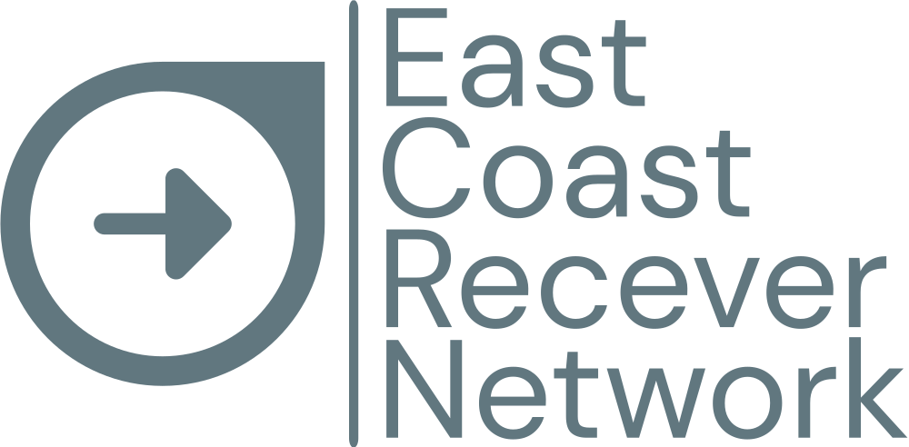

<p align="center">
  
</p>

<h1 align="center">ECRXN Dispatch</h1>

<p align="center">
  Tone detection and alerting for scanner and dispatch audio.<br>
  Runs on <b>Windows</b> and <b>Linux</b>. No Docker needed.<br>
  By the <a href="https://ecrxn.com">East Coast Receiver Network</a>.
</p>

---

ECRXN Dispatch takes call audio from your scanner software (RDIO Scanner, SDRTrunk, Trunk Recorder and other
RDIO-compatible uploaders), listens for paging tones, and when it hears a department's tones it alerts the people
who need to know, with the audio.

## Features

- **Tone detection**: two-tone (Quick Call), long tone, hi-low, pulsed and DTMF.
- **Triggers**: match a department's tones (optionally on one talkgroup) and alert only for the ones you care about.
- **Tones without a trigger**: a dashboard view listing every tone heard that no trigger covers yet. One click
  turns it into a trigger.
- **Alerts**: Telegram, Discord, Pushover, email, Facebook Pages, Make and n8n, for a whole system and for each
  trigger on its own. Send the audio as a link, a file, or both. On Facebook, a video or Reel over your own background.
- **Ready-made messages**: every alert starts with a working message, plus [placeholders](docs/alerts.md#placeholders)
  for the departments, time, transcript, address and more.
- **Backup and copying**: download a whole system (settings, triggers, alerts) as one file and import it anywhere.
  Tones as a spreadsheet.
- **Audio storage**: on the server, a second drive, S3-compatible storage or SFTP.
- **AI add-ons**: transcription, address finding and incident type (OpenAI or self-hosted).
- **Web dashboard** that works on phones, with login protection and a lockout for repeated wrong passwords.

**Try it first:** the [browser demo](https://www.bradford-business.net/ecrxn-dispatch-demo/) is the real dashboard running on made-up data.
Nothing to install, and nothing you type in it goes anywhere.

## Install

**Windows 10 / 11:** download **`ECRXN-Dispatch-Setup-<version>.exe`** from the
[latest release](https://github.com/TechWiz54/ECRXN-Dispatch/releases/latest) and run it. It brings its own Python
and ffmpeg, runs in the background and starts with Windows, with a tray icon by the clock to restart it or
change its settings.

**Linux:**

```bash
git clone https://github.com/TechWiz54/ECRXN-Dispatch.git
cd ECRXN-Dispatch
sudo ./install_linux.sh
```

Both installers write your settings file (`.env`) and show the dashboard address and your admin login. Then
follow **[Setup → First steps](docs/setup.md#first-steps)**. Lost the login? It's saved in `.env`:
[Setup → Forgot the admin password?](docs/setup.md#forgot-the-admin-password).

## Updating

Windows: run the newer setup program. Linux: `git pull`, then the installer again. Your settings, database and
saved audio are never part of a download, so they can't be overwritten, and database changes apply themselves on
the next start. Details: [Setup → Updating](docs/setup.md#updating).

## Documentation

| Guide | What's in it |
|---|---|
| [Setup](docs/setup.md) | Install, first steps, updating, forgotten password, HTTPS, security, settings |
| [Alerts](docs/alerts.md) | System and trigger alerts, sending the audio, Facebook, **every placeholder** |
| [Uploads](docs/uploads.md) | The upload address for your scanner software, and split tones/voice uploads |
| [AI features](docs/ai-features.md) | Transcription, address extraction, incident classification |
| [Backup and copying](docs/backup-and-transfer.md) | Export / import systems and triggers, the tones spreadsheet |

## Project layout

| | |
|---|---|
| `app.py`, `serve.py` | Starts the app (`serve.py` picks the web server for your system) |
| `lib/` | The work: tone matching, alerts, storage, AI, the database |
| `routes/` | The web pages and the API the dashboard and uploaders use |
| `templates/`, `static/` | The dashboard's pages, styles, scripts and images |
| `migrations/` | Database changes, applied in order on start |
| `docs/` | The guides and an example uploader |
| `public/` | Builds the browser demo (`build_demo.py`); the demo itself is hosted at [bradford-business.net](https://www.bradford-business.net/ecrxn-dispatch-demo/), not kept here |
| `install_linux.sh` | The Linux installer (the Windows setup program is built from `.github/windows-installer/`) |
| `var/`, `log/`, `static/audio/`, `.env` | Yours: database, logs, audio, settings. Made on your computer, never in git |

## Credits and license

ECRXN Dispatch is maintained by the [East Coast Receiver Network](https://ecrxn.com). It is based on
[iCAD Dispatch](https://github.com/TheGreatCodeholio/icad_dispatch) by TheGreatCodeholio, whose
[icad-tone-detection](https://pypi.org/project/icad-tone-detection/) library does the tone detection.

Licensed under the [GNU GPL v3](LICENSE): you may use, change and share it, and changed versions must also be
shared under the GPL v3.
